<picture>
  <source media="(prefers-color-scheme: dark)" srcset="./terminal-dark.svg" />
  <source media="(prefers-color-scheme: light)" srcset="./terminal-light.svg" />
  
</picture>

<br/>

```text
NAME
    Dedy Irama (@dedyirama-id) — Software Engineering & Applied ML

SYNOPSIS
    dedyirama [--backend] [--llm-rag] [--data-pipelines]

SELECTED WORK
    indonesian-labor-law-rag     QLoRA fine-tuning of Qwen2.5-1.5B on Indonesian instructions
                                 with hybrid-retrieval RAG & page-level legal citations.
    asep                         Adaptive Sepsis Prediction clinical decision support system.
    forum-api                    RESTful forum service built with Hapi, PostgreSQL & Clean Architecture.
    datawarehouse-etl            Automated data extraction, transformation & warehouse loading pipelines.
    kael-recommendation-system   Recommendation engine & backend services (Java / TypeScript).
```

<p align="right">
  <sub>
    <a href="https://github.com/dedyirama-id?tab=repositories">repositories</a> ·
    <a href="https://dedyirama-id.github.io">web</a>
  </sub>
</p>
